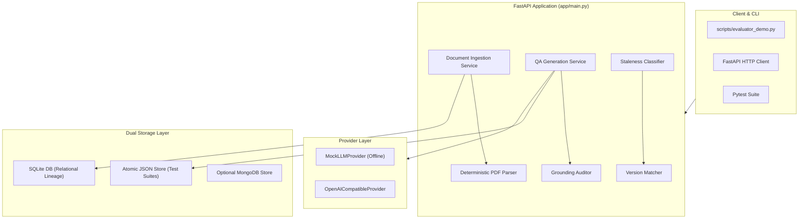

# CardioTrack CT-200 Medical Device Document Intelligence & QA Generation Engine

A high-reliability Document Intelligence, Relational Versioning, and Automated QA Traceability Engine built for the CardioTrack CT-200 Blood Pressure Monitor technical manuals.

Developed for the **Tri9T AI Internship Assignment**.

---

## 1. Project Overview

The CardioTrack CT-200 system transforms complex, unstructured medical device PDF manuals into structured, queryable, and version-tracked technical intelligence. It automatically extracts document hierarchies, tracks cross-version requirement drifts, generates structured QA test cases, and deterministically audits generated assertions against authoritative manual text.

- **Current Status:** Submission Ready (Stages 1–8 Complete)
- **Automated Test Suite:** **90 tests passing (100% pass rate)** across 10 test modules
- **Single-Command Reviewer Verification:** `python3 -m scripts.stage7_final_verification`
- **Interactive Evaluator Walkthrough:** `python3 -m scripts.evaluator_demo`
- **Offline Capable:** 100% functional without external network access, API keys, or cloud databases.

---

## 2. Problem Statement

Medical device software verification requires strict traceability between product specifications and QA test cases. However, technical manuals present severe engineering hurdles:
1. **Unstructured PDFs & Edge Cases:** Non-standard typography, missing parent headers (e.g. §2.1.1.1 jumping directly from §2.1), body-sized headings, duplicate section titles, and split tables.
2. **Silent Specification Drift:** Revisions modify safety-critical values (battery cycles, alarm thresholds, inflation step sizes) without unified changelogs.
3. **Stochastic LLM Hallucinations:** Using generative AI to draft test cases frequently invents unsupported tolerances (e.g. `±2 mmHg`), fabricated error codes, or wrong units.
4. **Unpinned Test Suites:** Test suites become invalid when documents change unless tied to immutable source snapshots.

---

## 3. Proposed Solution

This engine implements an end-to-end, deterministic engineering pipeline:

```
PDF Manuals (v1 & v2)
       │
       ▼
Deterministic PDF Parsing (pdfplumber typography extraction, IR-1 through IR-7 handling)
       │
       ▼
Immutable Versioned Relational Model (SQLite: Document, Version, LogicalNode, NodeVersion)
       │
       ▼
Cross-Version Change Detection (SHA-256 content hashing, multi-signal lineage matching)
       │
       ▼
Version-Pinned Named Selections (User-curated requirement subsets pinned to immutable snapshots)
       │
       ▼
Structured QA Test Generation (Configurable LLM provider: MockLLMProvider or remote OpenAI)
       │
       ▼
Deterministic Source-Grounding Audit (5-state claim evaluation: Supported, Derived, Setup, Unsupported, Ambiguous)
       │
       ▼
Dual Persistence & Retrieval (Relational SQLite lineage + Atomic JSON document store with flock)
       │
       ▼
Cross-Version Staleness & Impact Analysis (Automated flagging of modified requirements & deltas)
```

---

## 4. Key Features

### 1. Deterministic PDF Extraction Engine (`app/services/pdf_parser.py`)
- High-fidelity typography extraction using `pdfplumber` character geometry.
- Handles all **7 confirmed structural irregularities**:
  - **IR-1 (Missing Parent):** Section `2.1.1.1` cleanly attached to `2.1` with diagnostic warning.
  - **IR-2 (Body-Sized Headings):** Section `3.2` recognized as Level-2 heading despite 11pt font.
  - **IR-3 (Out-of-Order Headings):** Sections `3.4` and `3.3` preserved in exact source reading order.
  - **IR-4 (Duplicate Heading Names):** Sections `4.2` and `7.1` ("Error Codes") receive unique IDs.
  - **IR-5 (Phantom Table Filtering):** Geometric enclosure filtering strips phantom artifacts.
  - **IR-6 (Numbered Lists in 3.3):** Items 1–5 preserved as body text, not false section headings.
  - **IR-7 (Cross-Page Continuation):** Seamlessly joins multi-page sections (e.g. 3.1 across p2–p3).

### 2. Immutable Relational Versioning (`app/db/models.py`)
- Tracks conceptual documents, revisions (`DocumentVersion`), and sections (`NodeVersion`).
- Computes SHA-256 cryptographic hashes over normalized headings, bodies, and tables.
- Guarantees immutability: ingesting v2 leaves v1 node snapshots 100% untouched.

### 3. Version-Pinned Named Selections (`app/repositories/document_repository.py`)
- Enables QA engineers to define named verification scopes (e.g., "Safety-Critical Operations").
- Strictly pinned to an exact document version and node UUIDs; cannot silently slide across versions.

### 4. Explainable Staleness Classification (`app/services/staleness_classifier.py`)
- Categorizes changes into 11 granular classifications (`NUMERIC_CHANGE`, `TIMING_CHANGE`, `TABLE_ROW`, etc.).
- Precedence hierarchy guarantees numerical and timing changes take precedence over generic wording.
- Automatically extracts parameter deltas:
  - **§2.1.1.1:** Battery life `300` $\rightarrow$ `250 cycles`, warning `15%` $\rightarrow$ `10%`.
  - **§3.2:** Cuff inflation increment `40` $\rightarrow$ `30 mmHg`.
  - **§4.2:** Auto-deflation timing `2.0` $\rightarrow$ `1.5 seconds`, new error code `E6`.
  - **§5.3:** New section `5.3 Data Export` added in v2.

### 5. Grounded QA Test Generation (`app/services/qa_generation_service.py`)
- Pluggable provider abstraction (`MockLLMProvider` for deterministic offline testing, `OpenAICompatibleProvider` for live LLMs).
- Strict PascalCase Pydantic validation (`TestCaseId`, `Title`, `Prerequisites`, `Steps`, `ExpectedResult`, etc.).
- Bounded retries (maximum 3 attempts) and SHA-256 request idempotency.

### 6. Deterministic 5-State Grounding Auditor (`app/services/grounding_auditor.py`)
- Evaluates test assertions into 5 categories:
  1. `SOURCE_SUPPORTED`: Explicitly present in cited manual text.
  2. `DERIVED_WITH_EXPLANATION`: Verified arithmetic step progression (e.g. $180 + 40 = 220\text{ mmHg}$).
  3. `PROPOSED_SETUP`: External test bench equipment tagged `[PROPOSED SETUP]`.
  4. `UNSUPPORTED`: Invented tolerances (e.g. $\pm 2$ mmHg), unlisted codes, or contradictory negations.
  5. `AMBIGUOUS`: Conflicting citations or missing provenance.
- Automatically flags `human_review_required: true` on any ungrounded assertion.

---

## 5. System Architecture



For full architectural diagrams and component responsibilities, see [`docs/architecture.md`](docs/architecture.md).

---

## 6. Technology Stack

- **Language:** Python 3.10+ (tested on Python 3.13)
- **Web Framework:** FastAPI, Uvicorn
- **Data Validation & Contracts:** Pydantic v2
- **Relational Persistence:** SQLAlchemy 2.0, SQLite (PRAGMA foreign keys enforced)
- **PDF Extraction Engine:** `pdfplumber`
- **Testing & Verification:** Pytest
- **Document Storage:** Concurrency-safe JSON document store (with POSIX atomic rename and `fcntl.flock`) + optional MongoDB integration

---

## 7. Repository Structure

```
Tri9T-AI/
├── app/
│   ├── main.py                     # FastAPI REST API (18 documented endpoints)
│   ├── core/config.py              # Application settings and environment variables
│   ├── db/
│   │   ├── base.py                 # DeclarativeBase metadata
│   │   ├── models.py               # Document, DocumentVersion, LogicalNode, NodeVersion, Selection
│   │   └── session.py              # SQLAlchemy engine and SQLite sessionmaker
│   ├── prompts/qa_generation.py    # Prompts, formatting constraints, and injection boundaries
│   ├── repositories/
│   │   ├── document_repository.py  # Data access layer for relational entities
│   │   ├── json_test_suite_store.py# Atomic JSON store with advisory locking
│   │   ├── mongo_test_suite_store.py# Optional MongoDB document store
│   │   └── test_suite_store.py     # Document store factory
│   ├── schemas/
│   │   ├── api.py                  # API request/response schemas
│   │   ├── document.py             # Parser AST schemas
│   │   └── qa_test_case.py         # QA test case, provenance, and audit schemas
│   └── services/
│       ├── document_ingestion.py   # Atomic version ingestion service
│       ├── grounding_auditor.py    # 5-state deterministic grounding auditor
│       ├── impact_analyzer.py      # Selection and document impact analyzer
│       ├── llm_provider.py         # MockLLMProvider & OpenAICompatibleProvider
│       ├── pdf_parser.py           # Typography-based PDF parser (IR-1 to IR-7)
│       ├── qa_generation_service.py# QA test generation, validation, and staleness
│       ├── staleness_classifier.py # Explainable staleness classification engine
│       └── version_matcher.py      # Multi-signal cross-version lineage matching
├── data/
│   ├── ct200_manual.pdf            # CT-200 v1 manual (6 pages)
│   └── ct200_manual_v2.pdf         # CT-200 v2 manual (7 pages)
├── docs/
│   ├── architecture.md             # System architecture and Mermaid diagrams
│   ├── api-reference.md            # Comprehensive REST API reference
│   ├── evaluator-checklist.md      # Reviewer evaluation checklist
│   ├── evaluator-demo-guide.md     # 14-milestone walkthrough guide
│   ├── stage-7-final-report.md     # Complete Stage 7 verification matrix
│   ├── stage-7-grounding-red-team.md # 14 adversarial red-team test report
│   ├── stage-8-submission-plan.md  # Stage 8 submission hardening plan
│   └── examples/                   # Valid JSON sample responses
├── scripts/
│   ├── evaluator_demo.py           # 14-milestone evaluator walkthrough demo
│   ├── stage7_final_verification.py# Single-command verification runner
│   ├── final_acceptance_demo.py    # Stage 6 acceptance demo
│   ├── ingest_document.py          # CLI ingestion tool
│   └── inspect_manual.py           # PDF diagnostic tool
├── tests/
│   ├── test_grounding_red_team.py  # 14 dedicated adversarial grounding tests
│   ├── test_grounding_audit.py     # Grounding auditor tests
│   ├── test_parser_edge_cases.py   # Dedicated tests for IR-1 through IR-7
│   ├── test_pdf_parser.py          # PDF parser unit tests
│   ├── test_persistence.py         # Atomic store and document repository tests
│   ├── test_qa_generation.py       # QA generation service tests
│   ├── test_selections.py          # Named selections tests
│   ├── test_staleness_classifier.py# Staleness classifier unit tests
│   ├── test_versioning_and_ingestion.py # Ingestion & lineage tests
│   └── test_api.py                 # FastAPI route tests
├── pytest.ini                      # Pytest configuration
├── README.md                       # This project documentation
└── requirements.txt                # Project dependencies
```

---

## 8. Installation & Configuration

### 1. Prerequisites
- Python 3.10+
- Git

### 2. Setup Virtual Environment
```bash
git clone https://github.com/ibharath-ofcl/Tri9T-AI.git
cd Tri9T-AI

python3 -m venv .venv
source .venv/bin/activate
pip install -r requirements.txt
```

### 3. Environment Configuration
The application comes preconfigured for offline execution using SQLite and `MockLLMProvider`. No `.env` file is required for evaluation. To customize options, copy `.env.example`:
```bash
cp .env.example .env
```

---

## 9. Quick-Start Instructions

### Step 1: Run the Comprehensive Verification Runner (Recommended)
Executes all unit tests, the 14-milestone acceptance demo, red-team tests, and OpenAPI validation in one pass:
```bash
python3 -m scripts.stage7_final_verification
```

### Step 2: Run the Evaluator Walkthrough Demo
Visibly traces the full lifecycle from ingestion to staleness impact in ~0.6s:
```bash
python3 -m scripts.evaluator_demo
```

### Step 3: Launch the REST API & Explore Swagger Docs
```bash
uvicorn app.main:app --host 0.0.0.0 --port 8000
```
- **Interactive Swagger UI:** [http://localhost:8000/docs](http://localhost:8000/docs)
- **ReDoc:** [http://localhost:8000/redoc](http://localhost:8000/redoc)
- **System Health:** [http://localhost:8000/health](http://localhost:8000/health)

---

## 10. Testing & Verification

The project includes 90 automated tests across 11 test modules:

```bash
pytest -v
```

### Test Suite Breakdown
| Test Module | Tests | Focus Area |
| :--- | :---: | :--- |
| `tests/test_parser_edge_cases.py` | 7 | Edge cases IR-1 through IR-7 |
| `tests/test_pdf_parser.py` | 6 | Typography extraction, font metadata, tables |
| `tests/test_versioning_and_ingestion.py` | 8 | SQLite models, version snapshots, immutability |
| `tests/test_versioning_api.py` | 5 | Ingestion, section tree, node detail, search & diff APIs |
| `tests/test_selections.py` | 8 | Version-pinned selections CRUD & immutability |
| `tests/test_impact_and_selection_api.py` | 3 | Selection lifecycle, validation, and staleness/impact endpoints |
| `tests/test_staleness_classifier.py` | 11 | Precedence hierarchy, numerical & timing deltas |
| `tests/test_qa_generation.py` | 15 | PascalCase schema, bounded retries, idempotency & persistence |
| `tests/test_grounding_audit.py` | 9 | Deterministic 5-state claim categorization & cross-store audit |
| `tests/test_grounding_red_team.py` | 14 | 14 adversarial red-team grounding vectors |
| `tests/test_api.py` | 4 | Base FastAPI health, preview, and error routing |
| **Total** | **90** | **100% Pass Rate (0 failures)** |

---

## 11. Example Input & Output

Reviewers can inspect verified sample JSON files under [`docs/examples/`](docs/examples/):
- **Document Ingestion:** [`docs/examples/document_ingestion_response.json`](docs/examples/document_ingestion_response.json)
- **Cross-Version Diff:** [`docs/examples/version_difference_response.json`](docs/examples/version_difference_response.json)
- **Version-Pinned Selection:** [`docs/examples/named_selection_response.json`](docs/examples/named_selection_response.json)
- **Generated QA Test Case with Provenance:** [`docs/examples/generated_qa_test_case.json`](docs/examples/generated_qa_test_case.json)
- **Grounding Audit with Unsupported Claim:** [`docs/examples/grounding_audit_response.json`](docs/examples/grounding_audit_response.json)
- **Staleness Impact Analysis:** [`docs/examples/staleness_impact_response.json`](docs/examples/staleness_impact_response.json)

---

## 12. Evaluator Presentation & Defense Resources

Reviewers and assessors can access presentation slides, interactive walkthrough runbooks, and technical defense materials:
- **Slide Presentation (10 Slides):** [`docs/final-evaluator-presentation.md`](docs/final-evaluator-presentation.md)
- **Live Demo Runbook (5–7 Mins):** [`docs/final-live-demo-runbook.md`](docs/final-live-demo-runbook.md)
- **Technical Defense & Question Bank (27 Q&As + Pitches):** [`docs/final-project-defense-questions.md`](docs/final-project-defense-questions.md)
- **Final Submission & Reproducibility Audit:** [`docs/stage-10-final-submission-report.md`](docs/stage-10-final-submission-report.md)
- **Final Release Acceptance & Freeze:** [`docs/stage-12-final-release-acceptance.md`](docs/stage-12-final-release-acceptance.md)
- **Requirements Traceability Matrix (16/16 PASS):** [`docs/requirements-traceability.md`](docs/requirements-traceability.md)

---

## 13. Known Limitations

1. **Deterministic Heuristics:** The grounding auditor canonicalizes units, numbers, tolerances, and negations, but complex clinical deduplication requires human engineering judgment.
2. **Local Atomic Persistence:** SQLite and JSON stores use local OS-level atomicity (`os.replace` and `fcntl.flock`). Distributed 2-phase commit across SQLite and MongoDB is not implemented.
3. **Mock LLM Default:** The offline mock provider generates reproducible test cases based on CT-200 specifications. Live LLM testing requires configuring remote OpenAI credentials.

---

## 14. Safety & Intended-Use Disclaimer

> [!CAUTION]
> **Regulatory Disclaimer:**  
> This software is an engineering assignment prototype. It has **not** been certified, cleared, or validated under FDA 21 CFR Part 820, IEC 62304, ISO 13485, or ISO 14971.  
> All test assertions, parameter tolerances, and safety classifications generated by this system must be reviewed and approved by a qualified biomedical engineer prior to clinical use or execution on physical hardware.
