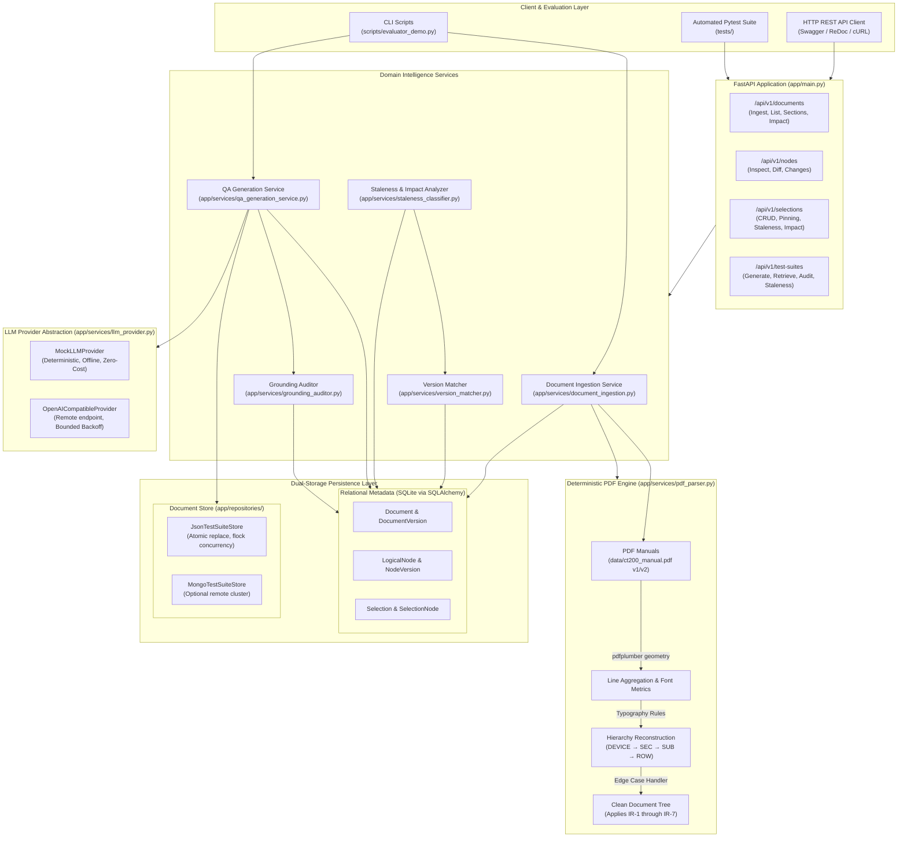
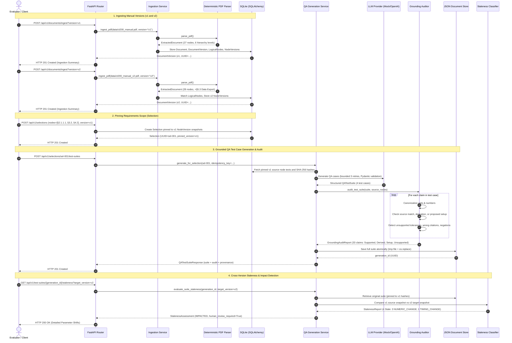

# System Architecture & Technical Data Flow

**CardioTrack CT-200 Medical Device Document Intelligence and QA Test Generation Engine**

---

## 1. Architectural Overview

The system is a deterministic, version-aware Document Intelligence and Automated QA Traceability Engine built for technical medical device manuals. It processes digital PDF manuals, constructs immutable hierarchical document trees, tracks cross-version requirement modifications, generates structured QA test cases, and deterministically audits generated assertions against authoritative manual text.

### Architectural Tenets
1. **Deterministic Foundations:** Core PDF extraction, hierarchy construction, cryptographic hashing, version diffing, and source-grounding checks use deterministic algorithms rather than stochastic LLM calls or lossy OCR.
2. **Immutability & Provenance:** Ingested document revisions and source nodes are immutable once created. QA test cases are cryptographically bound via SHA-256 hashes to specific source snapshots.
3. **Transparent Failure & Explainability:** The system classifies requirement changes into granular categories (`NUMERIC_CHANGE`, `TIMING_CHANGE`, `TABLE_ROW`), clearly identifies unsupported assertions, and flags `human_review_required: true`.
4. **Offline First & Zero Cloud Lock-in:** Operates fully offline with zero external network calls using SQLite, atomic JSON file storage, and `MockLLMProvider`. Pluggable to remote LLM APIs (`OpenAICompatibleProvider`) and MongoDB when configured.

---

## 2. System Architecture Diagram

---

## 3. End-to-End Execution Sequence Diagram

The following sequence diagram traces the complete lifecycle of ingesting manuals, creating a selection, generating QA test cases, auditing claims, and evaluating staleness when a new revision is introduced.

---

## 4. Component Details & Responsibility Matrix

The system enforces clear boundaries between deterministic logic, stochastic/model-driven generation, and operations requiring human review:

| Component | Primary File | Operation Type | Key Guarantees & Constraints |
| :--- | :--- | :--- | :--- |
| **PDF Extraction Engine** | `app/services/pdf_parser.py` | **Deterministic** | Extracts font geometry, size, and boldness via `pdfplumber`. Resolves all 7 structural irregularities (IR-1 through IR-7). Zero OCR or LLM hallucination. |
| **Relational Storage** | `app/db/models.py`, `app/repositories/` | **Deterministic** | SQLite with foreign key pragmas enforced. Generates SHA-256 hashes over canonicalized text. Ingesting duplicate versions returns `409 Conflict`. |
| **Version Matcher & Diff** | `app/services/version_matcher.py` | **Deterministic** | Multi-signal logical node matching (`section_number` exact match, heading similarity, hierarchy parentage). Computes unified diffs. |
| **Staleness Classifier** | `app/services/staleness_classifier.py` | **Deterministic** | 11 granular classifications with strict precedence (`TIMING_CHANGE` > `NUMERIC_CHANGE` > `WORDING_CHANGE`). Deterministic parameter shift extractor. |
| **LLM Provider Abstraction** | `app/services/llm_provider.py` | **Configurable** | `MockLLMProvider` is 100% deterministic and offline. `OpenAICompatibleProvider` implements bounded exponential backoff (max 3 retries). |
| **QA Generation Service** | `app/services/qa_generation_service.py` | **Model + Rules** | Enforces strict PascalCase Pydantic contracts (`TestCaseId`, `Steps`, `ExpectedResult`). Injects anti-injection boundaries. Idempotency enforced via SHA-256 keys. |
| **Grounding Auditor** | `app/services/grounding_auditor.py` | **Deterministic** | 5-state claim evaluation (`SOURCE_SUPPORTED`, `DERIVED_WITH_EXPLANATION`, `PROPOSED_SETUP`, `UNSUPPORTED`, `AMBIGUOUS`). Unit/number canonicalization, negation detection. |
| **Document Store** | `app/repositories/json_test_suite_store.py` | **Deterministic** | Atomic filesystem write (`.tmp` write followed by `os.replace`). File-level advisory locking prevents write interleaving. |
| **Human Review Gate** | UI / Reviewer Step | **Human Required** | Triggered whenever `human_review_required: true` is set (e.g., numerical shifts, timing deltas, unsupported tolerances, or missing provenance). |

---

## 5. Persistence Architecture & Concurrency Model

### 1. Relational Layer (SQLite via SQLAlchemy)
- Stores structural entities: `Document`, `DocumentVersion`, `LogicalNode`, `NodeVersion`, `Selection`, `SelectionNode`.
- Preserves relational integrity through foreign key cascades (`PRAGMA foreign_keys=ON`).
- Guarantees immutability: once written, `NodeVersion` rows are read-only. Modifying a requirement produces a new `NodeVersion` associated with a new `DocumentVersion`.

### 2. Document Store Layer (JSON with Optional MongoDB)
- Stores nested, schema-rich `QATestSuite` objects containing test cases, execution steps, parameter limits, provenance dictionaries, and grounding audit reports.
- **Atomic File Writing:** Writes to `{test_suite_id}.json.tmp` and executes an atomic POSIX filesystem rename (`os.replace`) to ensure crash consistency.
- **Advisory File Locking:** Employs `fcntl.flock` (exclusive lock during write) to guard against concurrent writer collisions.
- **Corrupted File Defense:** If a JSON file is manually damaged or zero-byte truncated, the store logs a structured diagnostic and raises `TestSuiteStoreError` rather than crashing silently.

---

## 6. Safety, Intended Use & Medical Device Disclaimer

> [!CAUTION]
> **Regulatory Disclaimer:**  
> This software is an engineering assignment prototype developed for the Tri9T AI Internship Assignment. It has **not** been certified, cleared, or validated under:
> - FDA 21 CFR Part 820 (Quality System Regulation)
> - IEC 62304 (Medical Device Software Lifecycle)
> - ISO 13485 (Medical Devices Quality Management)
> - ISO 14971 (Application of Risk Management to Medical Devices)
>
> All test assertions, parameter tolerances, and safety classifications generated by this system must be verified and approved by a qualified biomedical verification engineer prior to physical execution on test bench hardware or clinical instruments.
