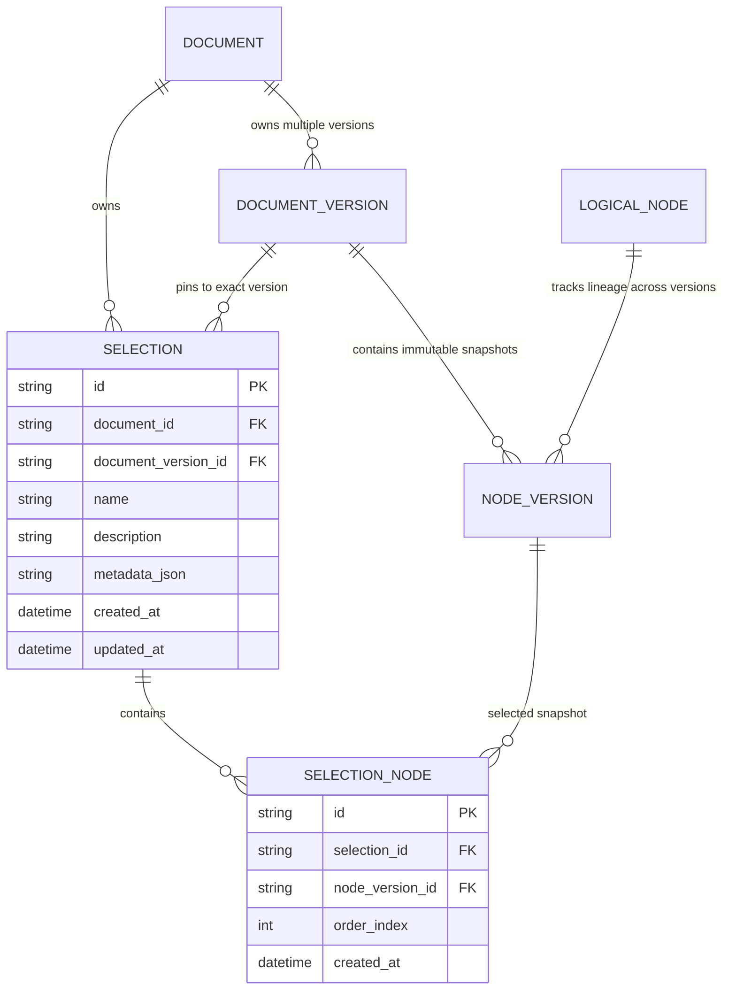
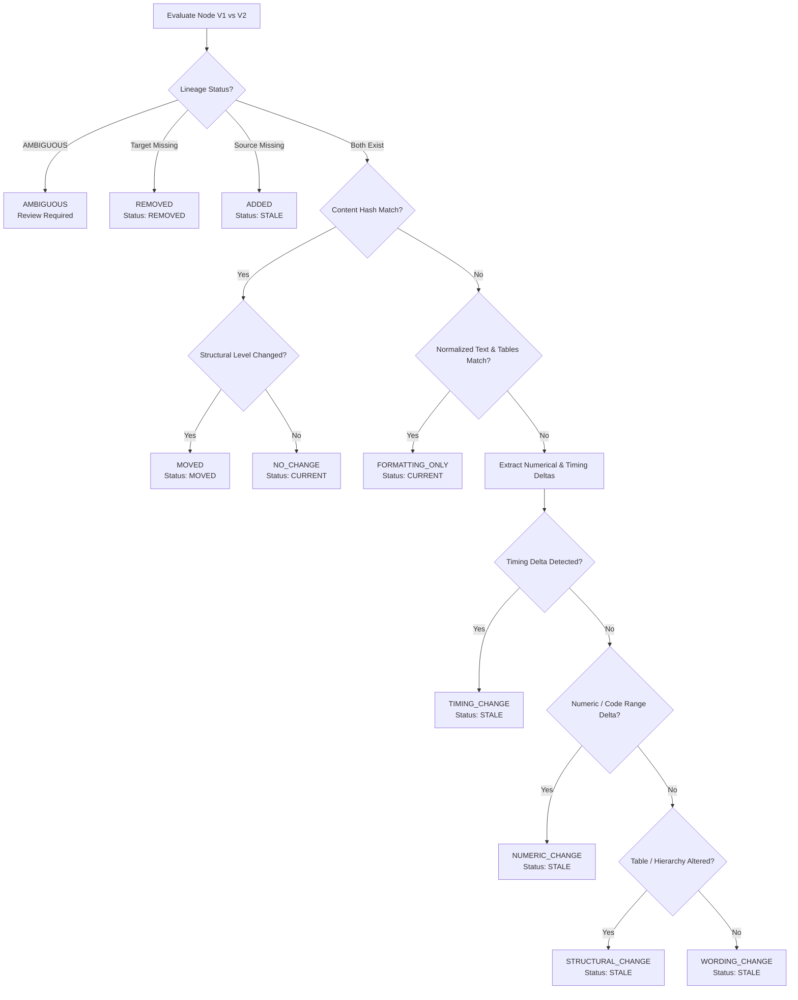

# Engineering Report: Stage 4 — Version-Pinned Selections, Explainable Staleness Classification & Impact Detection

**Project:** Tri9T AI Internship Assignment — Medical-Device Document Intelligence Engine  
**Device Under Test:** CardioTrack CT-200 Blood Pressure Monitor Manual (`v1` and `v2`)  
**Milestone:** Stage 4 Architecture & Implementation Report  
**Author:** Senior Backend Architect & Medical-Device Document Intelligence Specialist  
**Status:** Verified & Fully Implemented (52/52 Tests Passing)  

---

## 1. Executive Summary

In Stage 3, we built an immutable relational versioning and logical node lineage engine with SQLite and SQLAlchemy 2.0. In Stage 4, we extend this system to solve the core verification challenge of medical-device software engineering: **traceable, version-pinned test scope management and explainable revision impact detection**.

### Key Deliverables Completed:
1. **Version-Pinned Named Selections:** Relational schema (`Selection`, `SelectionNode`) allowing QA engineers to define named verification scopes bound to exact, immutable `NodeVersion` snapshots.
2. **Explainable Staleness Classifier (`StalenessClassifier`):** Rule-based engine categorizing node differences across versions into 11 granular states (`NO_CHANGE`, `FORMATTING_ONLY`, `WORDING_CHANGE`, `NUMERIC_CHANGE`, `TIMING_CHANGE`, `STRUCTURAL_CHANGE`, `ADDED`, `REMOVED`, `MOVED`, `AMBIGUOUS`, `UNCLASSIFIED`) with deterministic precedence and contextual evidence extraction.
3. **Contextual Delta Extractor:** Deterministic regex and context-matching engine identifying modified parameters (e.g., 300 $\rightarrow$ 250 battery cycles, 15% $\rightarrow$ 10% low-battery warning, 40 $\rightarrow$ 30 mmHg cuff inflation increments, 2s $\rightarrow$ 1.5s overpressure auto-deflation timing, and E6 Bluetooth sync table addition).
4. **Impact Detection Service (`ImpactAnalyzer`):** Selection-centric and document-wide impact analysis identifying affected scopes, changed parameters, and unaffected baselines upon document revision.
5. **REST API Endpoints:** 8 new FastAPI endpoints supporting Selection CRUD, version-filtered listing, staleness auditing, and document impact reporting.
6. **Verification Suite:** 22 new unit and integration tests (totaling 52 passing tests) and a deterministic end-to-end demonstration script (`scripts/demo_e2e_staleness.py`).

---

## 2. Selection & Version-Pinning Data Model

### 2.1 The Architectural Need for Version Pinning
In safety-regulated medical device software (IEC 62304 / ISO 13485), verification test suites are executed against a specific, approved version of a device specification. 

If a QA selection referenced only `LogicalNode.id` or whichever document version was currently latest:
- Ingesting a new draft (e.g. `v2`) would silently mutate the definition of historical test suites.
- Historical audit logs would become ambiguous regarding which specific specification numbers or sentences were verified.
- Regulatory traceability would be broken.

Therefore, our data model enforces that **a `Selection` is strictly pinned to one `DocumentVersion`**, and each `SelectionNode` links to a specific, immutable `NodeVersion` snapshot.

### 2.2 Relational Entity Relationship Diagram



### 2.3 Strict Database Invariants
1. **Single Pinned Version:** A selection references exactly one `document_version_id`.
2. **Homogeneous Version Membership:** All `SelectionNode` entries must belong to the selection's pinned `document_version_id` and `document_id`. Mixed-version selections are rejected with `400 Bad Request`.
3. **No Cascade Destruction of History:** Deleting a `Selection` deletes its `SelectionNode` links, but **never** deletes or mutates `NodeVersion` snapshots or `DocumentVersion` records.
4. **Order Preservation:** `SelectionNode.order_index` maintains insertion sequence deterministically.
5. **Deduplication:** Multiple references to the same `node_version_id` within a creation request are deduplicated transparently.

---

## 3. Explainable Staleness Classification

### 3.1 Classification Taxonomy & Precedence
When evaluating a node from version $V_1$ against target version $V_2$, the `StalenessClassifier` executes a strict, deterministic rule chain:



### 3.2 Category Meanings
| Category | Definition | Status | Human Review? | Example in CT-200 |
|---|---|---|---|---|
| `NO_CHANGE` | Exact cryptographic SHA-256 match. | `CURRENT` | No | §1.1 Intended Use, §2.1 System Components |
| `FORMATTING_ONLY` | Whitespace, line-wrap, or non-semantic character changes. | `CURRENT` | No | Normalizing trailing spaces or soft line wraps |
| `TIMING_CHANGE` | Temporal threshold (seconds, ms, duration) modified. | `STALE` | **Yes** | §4.2 E3 auto-deflation (2s $\rightarrow$ 1.5s) |
| `NUMERIC_CHANGE` | Measurement limit, pressure, cycles, or percentage modified. | `STALE` | **Yes** | §2.1.1.1 Battery (300 $\rightarrow$ 250 cycles, 15% $\rightarrow$ 10%); §3.2 Inflation (40 $\rightarrow$ 30 mmHg) |
| `STRUCTURAL_CHANGE` | Hierarchy depth (level) or table schema modified. | `STALE` | **Yes** | §4.2 Table addition of code E6 |
| `WORDING_CHANGE` | Semantic text updated without numeric/timing changes. | `STALE` | **Yes** | Revised explanatory note in section body |
| `ADDED` | Node newly introduced in target version. | `STALE` | **Yes** | §5.3 Data Export (new in v2) |
| `REMOVED` | Node deprecated or deleted in target version. | `REMOVED` | **Yes** | Deprecated section in updated manual |
| `MOVED` | Node moved to new parent/level with identical text. | `MOVED` | **Yes** | Relocated subsection |
| `AMBIGUOUS` | Competing lineage matches or low-confidence alignment. | `AMBIGUOUS` | **Yes** | Low-similarity heuristic match |
| `UNCLASSIFIED` | Fallback when evidence is contradictory. | `STALE` | **Yes** | Unresolvable diff |

### 3.3 Contextual Quantity Extraction
The extractor parses quantities with local surrounding context ($\pm 25$ characters) to avoid false pairings:
- **Timing:** `(\d+(?:\.\d+)?)\s*(seconds?|secs?|s|milliseconds?|ms|minutes?|mins?|hours?)`
- **Pressure:** `(\d+(?:\.\d+)?)\s*(mmHg|kPa|bar|psi)`
- **Cycle Counts:** `(\d+(?:\.\d+)?)\s*(measurement\s+cycles?|charge\s+cycles?|cycles?)`
- **Percentages:** `(\d+(?:\.\d+)?)\s*(%|percent)(?!\w)`
- **Error Codes:** `(E\d+(?:[–-]E\d+)?)`

Quantities between old and new versions are paired **only if** they share the same physical unit class and their surrounding context similarity ratio $\ge 0.45$. Unrelated numbers in unrelated sentences are never artificially paired.

---

## 4. Selection & Document Impact Analysis

### 4.1 Selection-Centric vs. Document-Centric Impact
The system answers two operational questions:
1. **Selection-Centric:** *"I am responsible for the 'Safety Critical Suite' pinned to v1. What changed in v2 that affects my test cases?"*
   - Analyzed via `GET /api/v1/selections/{id}/impact?target_version=v2`
2. **Document-Centric:** *"We just ingested CT-200 v2. Across all registered QA teams and selections pinned to v1, which selections are affected and need re-verification?"*
   - Analyzed via `GET /api/v1/documents/{id}/impact?from_version=v1&to_version=v2`

### 4.2 Aggregate Selection Status Precedence
A selection's high-level health is computed using strict precedence:
$$\text{AMBIGUOUS} > \text{IMPACTED} > \text{REVIEW\_REQUIRED} > \text{CURRENT}$$

- **`CURRENT`**: 100% of selected nodes have identical content or formatting-only changes.
- **`REVIEW_REQUIRED`**: At least one node has wording or structural changes.
- **`IMPACTED`**: At least one node has a removed section, timing change, or numeric threshold change.
- **`AMBIGUOUS`**: At least one node has ambiguous lineage.

**Invariant:** The aggregate status never hides node-level details. All per-node reports and deltas are preserved in the response.

---

## 5. Medical-Device Safety & Regulatory Disclaimer

In medical device risk management (ISO 14971), an automated diff tool is an **inspection aid**, not a clinical validator:
> [!IMPORTANT]
> **Regulatory Disclaimer:**  
> Automated impact and staleness classification is a software traceability and change-analysis aid, not clinical validation or regulatory approval. All detected changes require verification by qualified QA/regulatory personnel.

- We do **not** claim a change is clinically safe merely because text similarity is high.
- We do **not** label a change "clinically hazardous" purely via regex; we report objective numerical and temporal shifts.
- Any change in operational parameters automatically flags `human_review_required: true`.

---

## 6. Real CT-200 Manual Comparison Findings (v1 $\rightarrow$ v2)

Executing the Stage 4 engine against the actual CT-200 PDFs produces verified empirical results:

### 1. §2.1.1.1 Battery Life Under Typical Use
- **Classification:** `NUMERIC_CHANGE` (Status: `STALE`)
- **Hash Shift:** `dec9f4eebc56542f...` $\rightarrow$ `b9c61e1251c19b2b...`
- **Detected Deltas:**
  - `300 measurement cycles` $\rightarrow$ `250 measurement cycles`
  - `15%` $\rightarrow$ `10%` low-battery warning threshold
- **Regulatory Impact:** Battery test cases verifying 300 cycles will fail against v2 devices. Test procedures must be updated to 250 cycles.

### 2. §3.2 Cuff Inflation Sequence
- **Classification:** `NUMERIC_CHANGE` (Status: `STALE`)
- **Hash Shift:** `547758b53703d0eb...` $\rightarrow$ `ad8e038d720a90c2...`
- **Detected Deltas:**
  - `40 mmHg increments` $\rightarrow$ `30 mmHg increments`
- **Regulatory Impact:** Pressure sensor test cases verifying step increments must adjust tolerances from 40 to 30 mmHg.

### 3. §4.2 Error Codes
- **Classification:** `TIMING_CHANGE` (Status: `STALE`)
- **Hash Shift:** `96be26dc07b58c1e...` $\rightarrow$ `8f3513b8bcb97ca8...`
- **Detected Deltas:**
  - Auto-deflation timing for code E3: `2 seconds` $\rightarrow$ `1.5 seconds`
  - New table entry added: `E6 | Bluetooth sync failure`
- **Regulatory Impact:** Timing-critical overpressure test cases must verify auto-deflation within 1.5s instead of 2.0s. New test case required for E6.

### 4. §5.3 Data Export
- **Classification:** `ADDED` (Status: `STALE`)
- **Boundary Verification:** Confirmed present in v2, but strictly excluded from any v1-pinned selection.

---

## 7. REST API Reference

### 7.1 Selection CRUD

#### `POST /api/v1/selections`
Create a named selection pinned to a version.
```bash
curl -X POST "http://localhost:8000/api/v1/selections" \
  -H "Content-Type: application/json" \
  -d '{
    "name": "Safety Baseline Suite",
    "description": "Battery, inflation, and error code verification",
    "version_label": "v1",
    "node_version_ids": [
      "2270fac6-...",
      "656c46f4-...",
      "c1b2b6c3-..."
    ]
  }'
```
**Response (201 Created):**
```json
{
  "id": "6448de41-986f-4ac0-b8ae-87a29b824b06",
  "document_id": "3e3f1d91-f390-4cf7-910d-115271b2034b",
  "document_version_id": "ff5063c3-5620-43d7-9a3c-6bf628fd79de",
  "version_label": "v1",
  "name": "Safety Baseline Suite",
  "description": "Battery, inflation, and error code verification",
  "created_at": "2026-10-23T00:06:23.123456Z",
  "updated_at": "2026-10-23T00:06:23.123456Z",
  "total_nodes": 3,
  "nodes": [...]
}
```

#### `GET /api/v1/selections`
List selections with optional filtering:
```bash
curl "http://localhost:8000/api/v1/selections?version=v1"
```

#### `GET /api/v1/selections/{selection_id}`
Retrieve full selection details and all pinned node snapshots.

#### `PATCH /api/v1/selections/{selection_id}`
Update selection name, description, or node IDs within the same pinned version.

#### `DELETE /api/v1/selections/{selection_id}`
Delete the selection entity without affecting document history or node snapshots.

---

### 7.2 Staleness & Impact APIs

#### `GET /api/v1/selections/{selection_id}/staleness?target_version=v2`
Evaluate selection staleness against target version v2.
```bash
curl "http://localhost:8000/api/v1/selections/6448de41-.../staleness?target_version=v2"
```
**Sample Response:**
```json
{
  "selection_id": "6448de41-...",
  "selection_name": "Safety Baseline Suite",
  "pinned_version_label": "v1",
  "target_version_label": "v2",
  "aggregate_status": "IMPACTED",
  "summary": {
    "total": 3,
    "current": 0,
    "stale": 3,
    "removed": 0,
    "moved": 0,
    "ambiguous": 0
  },
  "human_review_required": true,
  "disclaimer": "Notice: Automated impact and staleness classification is a software traceability and change-analysis aid...",
  "node_assessments": [
    {
      "node_version_id": "2270fac6-...",
      "logical_node_id": "log-001",
      "section_number": "2.1.1.1",
      "heading": "2.1.1.1 Battery Life Under Typical Use",
      "from_version_label": "v1",
      "to_version_label": "v2",
      "status": "STALE",
      "classification": "NUMERIC_CHANGE",
      "from_content_hash": "dec9f4eebc56...",
      "to_content_hash": "b9c61e1251c1...",
      "deltas": [
        {
          "delta_type": "NUMERIC",
          "old_value": "300",
          "new_value": "250",
          "unit": "measurement cycles",
          "context": "Old: '...provide approximately 300 measurement cycles...' -> New: '...provide approximately 250 measurement cycles...'",
          "explanation": "Numerical value modified from 300 measurement cycles to 250 measurement cycles."
        },
        {
          "delta_type": "NUMERIC",
          "old_value": "15",
          "new_value": "10",
          "unit": "%",
          "context": "Old: '...falls below 15%.' -> New: '...falls below 10%.'",
          "explanation": "Numerical value modified from 15 % to 10 %."
        }
      ],
      "explanation": "Operational numerical parameter, battery limit, or pressure increment modified.",
      "human_review_required": true,
      "evidence_level": "HIGH"
    }
  ]
}
```

#### `GET /api/v1/selections/{selection_id}/impact?target_version=v2`
Partition nodes into `affected_nodes` and `unaffected_nodes`.

#### `GET /api/v1/documents/{document_id}/impact?from_version=v1&to_version=v2`
Document-wide impact report across all registered selections.

---

## 8. Test Execution Results

All 52 automated tests passed cleanly:
```
tests/test_api.py (4 tests) - PASSED
tests/test_parser_edge_cases.py (7 tests) - PASSED
tests/test_pdf_parser.py (6 tests) - PASSED
tests/test_versioning_and_ingestion.py (8 tests) - PASSED
tests/test_versioning_api.py (5 tests) - PASSED
tests/test_selections.py (8 tests) - PASSED
tests/test_staleness_classifier.py (11 tests) - PASSED
tests/test_impact_and_selection_api.py (3 tests) - PASSED

======================== 52 passed, 1 warning in 5.35s =========================
```

---

## 9. Stage 5 Integration Contract (LLM-Generated QA Test Cases)

Stage 5 will introduce automated test-case generation using LLMs. Stage 4 prepares a clean, zero-risk interface:
1. **Selection as Generation Input:** Stage 5 takes a `Selection` ID, reads its exact, immutable `NodeVersion` bodies, tables, and page ranges.
2. **Provenance Hash Binding:** Every generated QA test case will store:
   - `selection_id`: Reference to the pinned selection.
   - `source_node_version_id`: Exact snapshot used during prompt generation.
   - `source_content_hash`: Cryptographic proof of source text at generation time.
3. **Automated Cross-Version Test Staleness:** When v2 is ingested, Stage 4's `StalenessClassifier` checks if `source_content_hash == current_node_version.content_hash`. If hashes diverge, the test case is flagged as `STALE (Threshold Changed)` or `STALE (Wording Changed)`.
4. **No LLM in Stage 4:** SQLite and deterministic rules remain clean and decoupled from external API keys or token consumption.

---

## 10. Conclusion & Acceptance Checklist

| Requirement | Status | Evidence |
|---|---|---|
| Version-pinned Selection & SelectionNode models | **COMPLETE** | `app/db/models.py`, `app/repositories/document_repository.py` |
| Selection CRUD and validation endpoints | **COMPLETE** | `POST/GET/PATCH/DELETE /api/v1/selections` |
| 11-category explainable staleness classification | **COMPLETE** | `app/services/staleness_classifier.py` |
| Numerical and timing delta extraction | **COMPLETE** | Battery (300 $\rightarrow$ 250), inflation (40 $\rightarrow$ 30), deflation (2s $\rightarrow$ 1.5s) |
| Selection & Document impact detection APIs | **COMPLETE** | `/selections/{id}/impact`, `/documents/{id}/impact` |
| Medical-device safety disclaimers & human review flags | **COMPLETE** | Preserved across all impact & staleness responses |
| Real CT-200 v1 $\rightarrow$ v2 demonstration | **COMPLETE** | `python3 -m scripts.demo_e2e_staleness` |
| Comprehensive test suite | **COMPLETE** | 52/52 tests passing via `pytest` |
